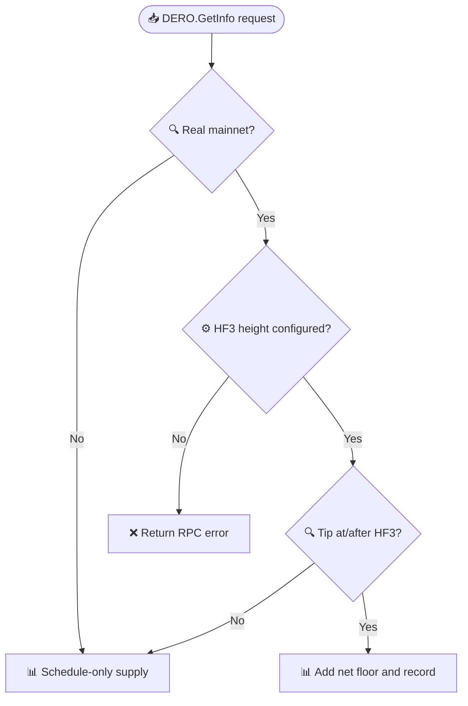

# DERO.GetInfo forensic supply record

_Mainnet reporting contract for the evidence-bounded created-supply floor; no balance or consensus mutation._

---

## 📋 API behavior

`DERO.GetInfo` keeps `total_supply` as the height-based emission schedule. The optional `created_supply_floor` object carries the forensic record separately. `spendable_supply` is schedule-only before the mainnet HF3 gate and schedule plus the **net created-supply floor** at or after that gate. The floor is evaluated at the current tip height, not the next block.

The record is returned only when all of these are true:

- The configured network is `mainnet`
- The daemon is not running as a simulator
- The current chain height is at or above `MAJOR_HF3_HEIGHT`

Testnet, simulator, and pre-HF3 responses omit `created_supply_floor` and do not add the floor to `spendable_supply`. A mainnet configuration with a missing or invalid HF3 height fails closed instead of silently publishing a record.

> ⚠️ **Compatibility note:** `spendable_supply` keeps its JSON field name, but its value is now gated and net of the verified burn. Integrators should read `created_supply_floor` and must not interpret either field as a balance census or audited circulating supply.

## 📊 Current record

Amounts in the record are atomic DERO units (**100,000 atomic units per DERO**). `total_supply` and `spendable_supply` remain whole-DERO values and truncate fractional units; the record retains exact atomic amounts.

| Record field | Atomic units | DERO | Definition |
|---|---:|---:|---|
| `gross_created_floor_atomic_units` | 2,388,651,730,000 | 23,886,517.3 | Established created coin; undecoded affected transactions excluded |
| `verified_burn_atomic_units` | 500,000,000,000 | 5,000,000 | Same-era chain-verified burn; exploit-wallet attribution unproven |
| `net_created_floor_atomic_units` | 1,888,651,730,000 | 18,886,517.3 | Gross floor less verified burn |

The JSON object also includes a record version, metric label, unit scale, scope note, evidence references, and `burn_attribution_proven: false`. The net arithmetic does **not** prove the burn came from exploit wallets or estimate how many affected coins remain outstanding. The record is a forensic floor, not an estimate of outstanding exploit coins, a balance census, or circulating supply.

At reference height `7,545,119`, the checked whole-DERO fields are `total_supply = 16,756,595` and `spendable_supply = 35,643,112`. These values are pinned by the supply tests.

## 🔗 Evidence and maintenance

The record is compiled into the daemon and validated against the pinned figures. Its evidence references are fixed and tested for presence:

- [Decision statement](DERO-STATEMENT_2608.md)
- [Tracked flow and reconciled amounts](TRACKED-FLOW.html)
- [Public explanation](PUBLIC-EXPLAINER.html)

The tracked-flow test parses all 46 evidence rows and verifies the gross floor and burn amounts in atomic units. Changing the record requires a code change, updated evidence, reconciled arithmetic, and a new record version.

## ⚙️ HF4 release boundary

This reporting feature is included in the HF4-capable daemon branch, but it is **not an HF4 consensus rule**. Its reporting gate remains mainnet HF3 because the record describes the historical HF3-era event. It does not alter `total_supply`'s emission formula, account balances, transaction validity, or block consensus. See [HF4 consensus and reporting integration](../hf4-consensus.md) and the existing [seamless-migration design](../seamless-migration.md).

