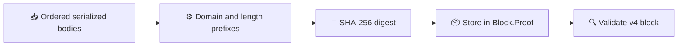

# HF4 consensus and reporting integration

_Implementation notes for node operators and integrators. Mainnet HF4 activation remains unscheduled._

---

## ⚙️ Transaction-body commitment

HF4 blocks bind the exact **ordered serialized transaction bodies**, including proof bytes, to the existing `Block.Proof` header field. The commitment input is encoded as:

1. Domain bytes `DERO/HF4/TX-BODIES\x00`
2. Unsigned-varint transaction count
3. For each transaction in block order: unsigned-varint body length, then the exact serialized body
4. SHA-256 of the resulting byte sequence

The digest is stored in `Block.Proof`. Transaction IDs alone are not a substitute for this body commitment.

The implementation is in [`block/transaction_commitment.go`](../block/transaction_commitment.go). The miner constructs the commitment in [`blockchain/miner_block.go`](../blockchain/miner_block.go); block admission, stored-block loading, and bootstrap validation check it in [`blockchain/blockchain.go`](../blockchain/blockchain.go), [`blockchain/store.go`](../blockchain/store.go), and [`p2p/chain_bootstrap.go`](../p2p/chain_bootstrap.go). Fixed-vector, body-mutation, transaction-order, and block-ID tests are in [`block/transaction_commitment_test.go`](../block/transaction_commitment_test.go).

## 🔒 Activation and migration

The commitment applies to version-four blocks under the configured HF4 activation schedule. Mainnet `MAJOR_HF4_HEIGHT` is currently unscheduled; this document does not set an activation height or announce a release date. Testnet configuration activates HF4 at genesis.

The deterministic seamless-migration marker is installed at the configured activation height. Its wallet routing, privacy boundary, consensus constraints, and simulator coverage are described in [Seamless migration: confidential transfer path](seamless-migration.md). A migration call does not bypass the v4 block commitment.

## 📊 Forensic supply reporting

The forensic `created_supply_floor` record and `spendable_supply` adjustment are daemon reporting changes, not block-consensus changes. They are gated by the **current mainnet HF3 height**, not by HF4. Testnet and simulator responses omit the record, including simulators that retain mainnet configuration.

`total_supply` remains the scheduled emission calculation. The reporting floor is net of the chain-verified same-era burn, with wallet attribution explicitly unproven. No balances are reissued, clawed back, migrated, or otherwise changed. See the [GetInfo supply contract](forensics/DERO-GETINFO-SUPPLY.md) for field semantics, evidence, and compatibility details.

## 🧪 Release verification

Before release, run the repository's offline, vendored tests for the affected consensus, RPC, migration, and explorer packages. The core acceptance checks are:

- V4 commitment vector and body/order binding tests
- Block, store, and bootstrap commitment validation tests
- HF4 migration activation, malformed-call, and simulator reorg tests
- Forensic-supply arithmetic, evidence-presence, network-gate, RPC serialization, and reference-height tests
- Explorer template rendering and data-population tests

The reporting changes must not change historical block acceptance or balances. Any proposal to alter balances or issuance is a separate consensus migration and requires its own activation, evidence, proofs, and adversarial tests.
